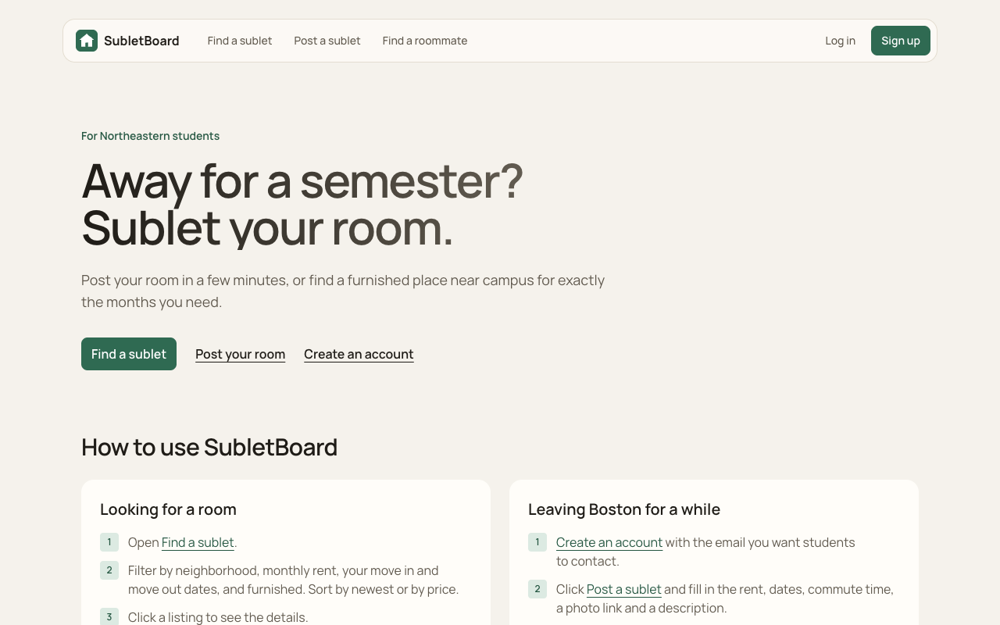
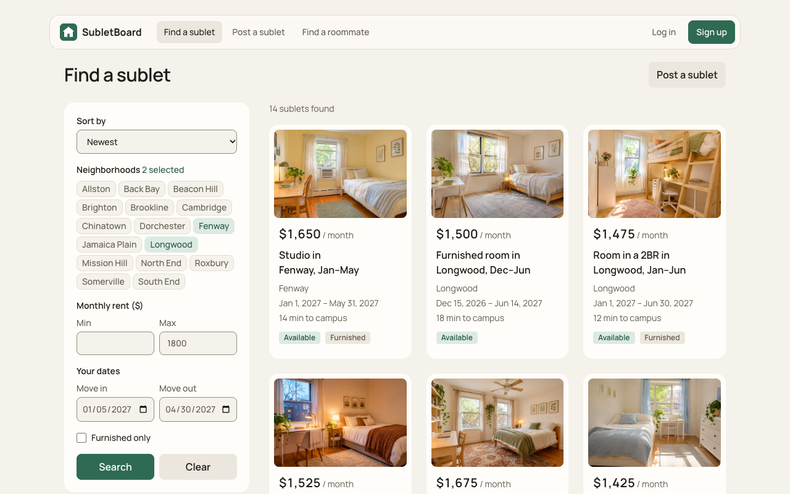
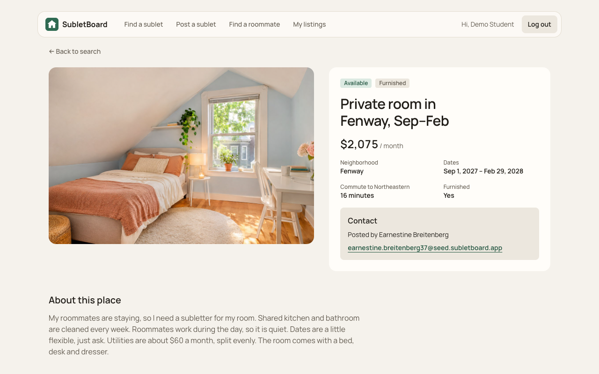
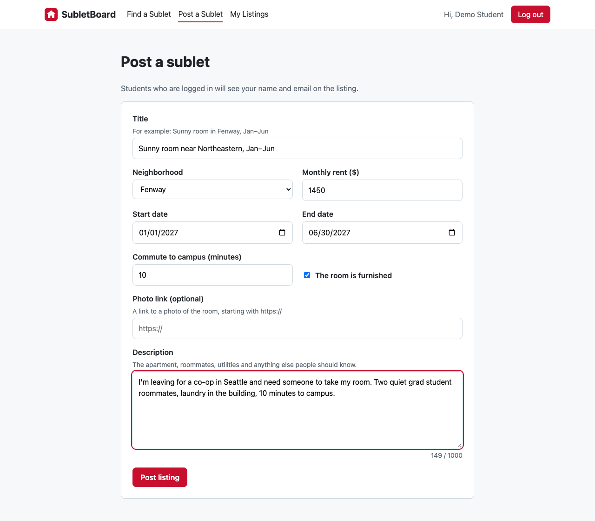
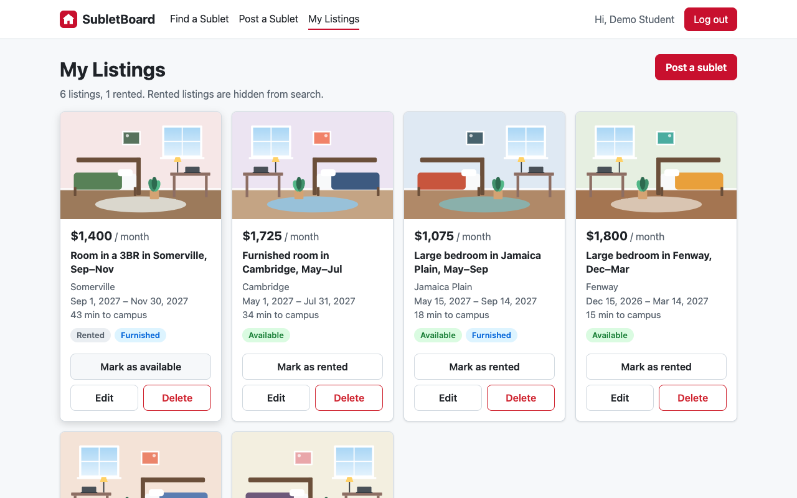
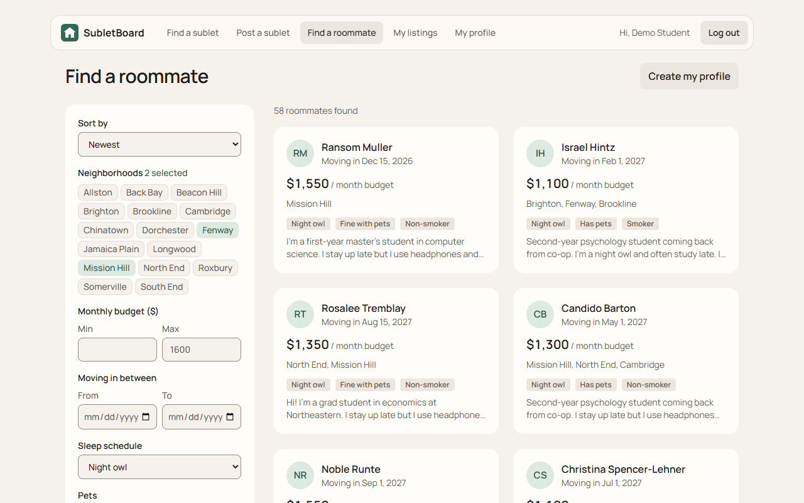
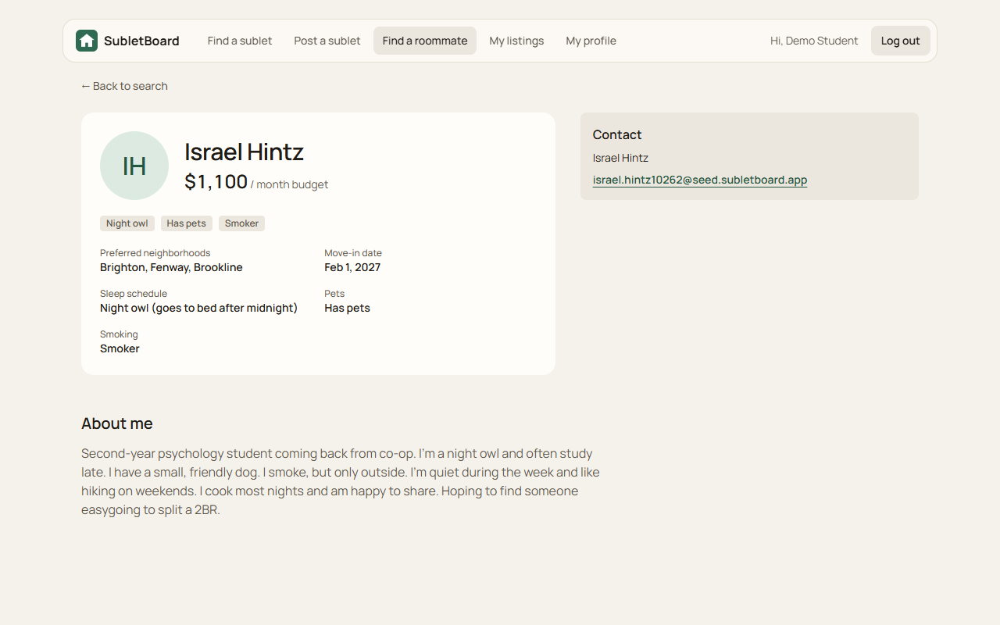
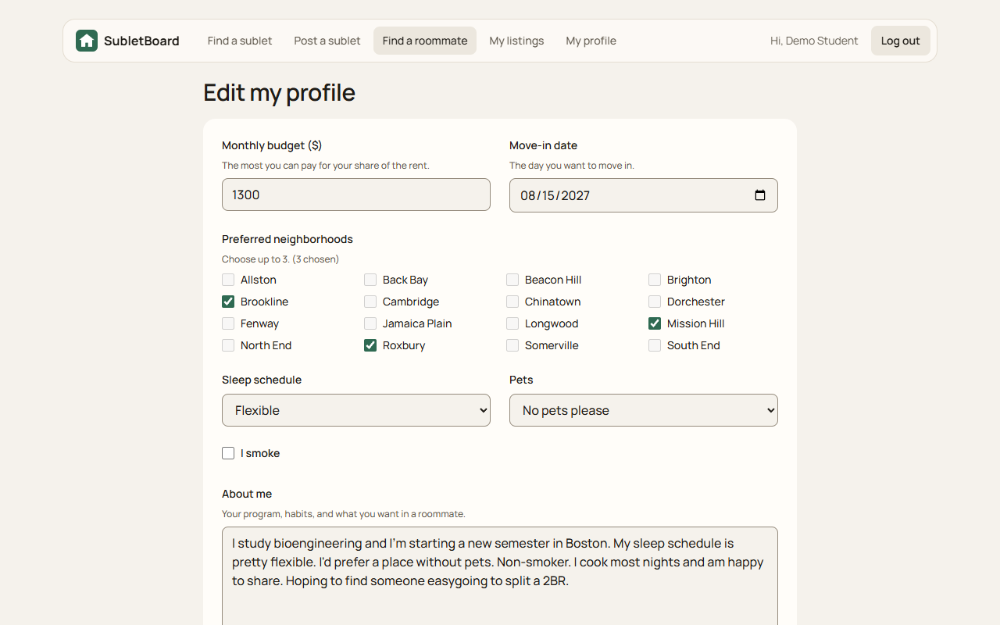
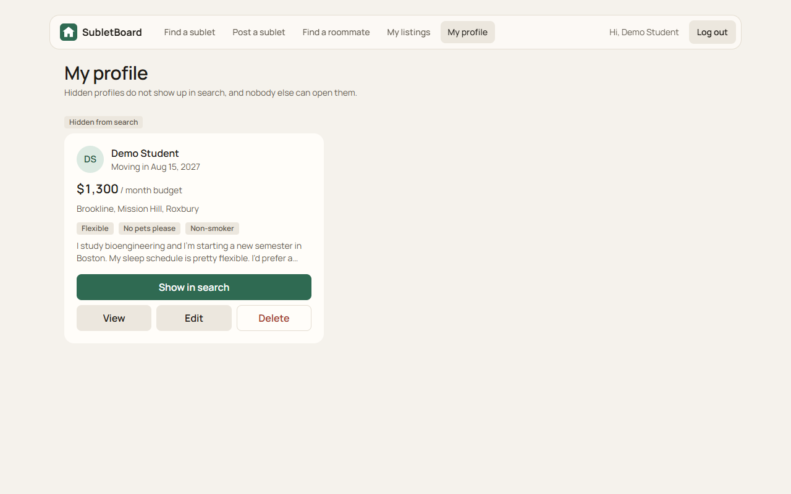
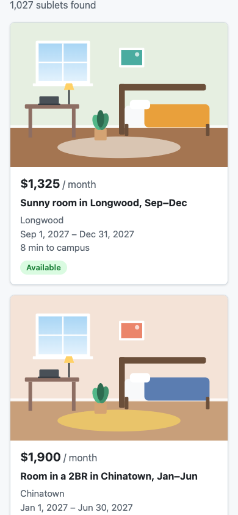

# SubletBoard

Sublets and roommates for Northeastern students.


## Authors

- Jiaying Guo
- Yanli Wang

## Class

[CS5610 Web Development, Fall 2026](https://johnguerra.co/classes/webDevelopment_online_fall_2026/), Northeastern University

## Project Objective

Many Northeastern students leave Boston for a co-op or a semester and need someone to take their room, while new students need a short-term place to stay or someone to split rent with. Right now this happens in messy Facebook groups and group chats, where posts get buried and are hard to search. SubletBoard gives students one place to post and find sublets, and to find a roommate who fits their budget and lifestyle.

## Features

### Sublet listings (Jiaying Guo)

- Sign up and log in with an email and password. Only the author can edit or delete their own listings.
- Post a sublet with a title, neighborhood, monthly rent, start and end dates, furnished or not, commute time to campus, a photo link and a description. Edit or delete it later.
- Search sublets by neighborhood (more than one at a time), price range, move-in and move-out dates, and furnished. Sort by newest or by price, 12 results per page. The search is kept in the address bar, so the back button, refresh and shared links all work.
- Open a listing to see its details. Students who are logged in can see the poster's contact email.
- See all your listings on the My listings page, and mark a listing as rented. Rented listings are hidden from search and no longer show the email, so people stop writing.

### Roommate profiles (Yanli Wang)

- Create, edit and delete a roommate profile, and hide or show it in search.
- Search profiles by budget, neighborhood, move-in date, sleep schedule, pets and smoking.

## Screenshots

Home page with instructions:



Search with filters (Fenway or Longwood, up to $1,800, January 5 to April 30):



Listing details, logged in:



Posting a sublet:



My listings, with one listing marked as rented:



Find a roommate, filtered to night owls in Fenway or Mission Hill with a budget up to $1,600:



A roommate profile, logged in:



Editing my roommate profile:



My profile, hidden from search:



On a phone:



## Links

- Deployed app: <https://subletboard.onrender.com>
- Design document and mockups: [design/DesignDocument.md](design/DesignDocument.md)
- Demo video: <https://youtu.be/ZEBFYs22h-U>

### Slides

| Author      | Slides                                                                                                                | Slides presentation                                                                             |
| ----------- | --------------------------------------------------------------------------------------------------------------------- | ----------------------------------------------------------------------------------------------- |
| Jiaying Guo | [Google Slides](https://docs.google.com/presentation/d/1afbz4ZV1ONuz97Up50KFeHn6-_NBZc4-eR_-MSkoPNQ/edit?usp=sharing) | [Video](https://drive.google.com/file/d/12_3IDjP76QZK2xlkVfPEhb4J76QjS0cF/view?usp=sharing)     |
| Yanli Wang  | [Google Slides](https://drive.google.com/drive/folders/1BhFrhYaWvC7Awt5wX8JZcn-sODwnkNa8)                       | [Video](https://drive.google.com/drive/folders/1BhFrhYaWvC7Awt5wX8JZcn-sODwnkNa8) |

## How to Use

You can browse and search without an account. To post a sublet, create a roommate profile or see a contact email, sign up or use the demo account:

- Email: `demo@subletboard.app`
- Password: `demo1234`

1. **Find a room:** open **Find a sublet**, choose neighborhoods, a price range, your move-in and move-out dates and furnished, then click **Search**. Click a listing to see the details and the poster's email.
2. **Post your room:** click **Post a sublet**, fill in the form and click **Post listing**.
3. **Manage your rooms:** open **My listings** to edit or delete a listing, or click **Mark as rented** when someone takes the room.
4. **Find a roommate:** open **Find a roommate**, choose neighborhoods, a budget range, move-in dates, sleep schedule, pets and smoking. Click a profile to see the details and the student's email.
5. **Create your profile:** on **Find a roommate**, click **Create my profile**, fill in your budget, neighborhoods, move-in date, lifestyle and a short bio, and click **Create profile**. Each student has one profile. If you already have one, the button opens it for editing.
6. **Hide or show your profile:** open **My profile** to edit or delete it. Click **Hide from search** after you find a roommate, so nobody else can find or open it, and **Show in search** when you are looking again.

The deployed app runs on Render's free plan. If it has not been used for a while, the first page can take about a minute to load.

## Tech Stack

- Frontend: React (hooks), React Router, Fetch API, PropTypes, Vite, Manrope font (Google Fonts)
- Backend: Node.js, Express 5
- Authentication: Passport (local strategy) with sessions saved in MongoDB (connect-mongo)
- Database: MongoDB (native Node.js driver)
- Synthetic data: @faker-js/faker

## Data

| Collection  | Records                                   | Notes                                              |
| ----------- | ----------------------------------------- | -------------------------------------------------- |
| `sublets`   | 1,200 synthetic listings, plus user posts | Full create, read, update and delete (Jiaying Guo) |
| `roommates` | Synthetic profiles, plus user profiles    | Full create, read, update and delete (Yanli Wang)  |
| `users`     | 101 synthetic students (one is the demo)  | Passwords are hashed with scrypt                   |
| `sessions`  | Login sessions                            | Created by connect-mongo, expire after 7 days      |

The seed scripts use a fixed Faker seed, so they create the same data every time. They only replace records marked `seeded: true`, so real accounts and listings are kept. The sample listings use 20 room photos that come with the app (`frontend/public/rooms`). The photos are AI generated and do not show real apartments.

## API

All responses are JSON. Errors look like `{ "error": "message" }`.

| Method | Path                            | Who       | Description                                                                                                                                                                                                                                         |
| ------ | ------------------------------- | --------- | --------------------------------------------------------------------------------------------------------------------------------------------------------------------------------------------------------------------------------------------------- |
| POST   | `/api/auth/signup`              | Anyone    | Create an account and log in                                                                                                                                                                                                                        |
| POST   | `/api/auth/login`               | Anyone    | Log in with email and password                                                                                                                                                                                                                      |
| POST   | `/api/auth/logout`              | Logged in | Log out                                                                                                                                                                                                                                             |
| GET    | `/api/auth/me`                  | Anyone    | The current user, or `null`                                                                                                                                                                                                                         |
| GET    | `/api/sublets`                  | Anyone    | Search: `neighborhood` (repeat for more), `minRent`, `maxRent`, `moveIn`, `moveOut`, `furnished=true`, `sort` (`newest`, `rent_asc`, `rent_desc`), `page`, `limit`                                                                                  |
| GET    | `/api/sublets/mine`             | Logged in | Your listings, including rented ones                                                                                                                                                                                                                |
| GET    | `/api/sublets/:id`              | Anyone    | One listing. The email is included for logged-in users while it is available                                                                                                                                                                        |
| POST   | `/api/sublets`                  | Logged in | Create a listing                                                                                                                                                                                                                                    |
| PUT    | `/api/sublets/:id`              | Author    | Edit a listing                                                                                                                                                                                                                                      |
| PATCH  | `/api/sublets/:id/status`       | Author    | `{ "status": "rented" }` or `{ "status": "available" }`                                                                                                                                                                                             |
| DELETE | `/api/sublets/:id`              | Author    | Delete a listing                                                                                                                                                                                                                                    |
| GET    | `/api/roommates`                | Anyone    | Search: `neighborhood` (repeat for more), `minBudget`, `maxBudget`, `moveInFrom`, `moveInTo`, `sleep`, `pets`, `smoking` (`yes`, `no`), `sort` (`newest`, `budget_asc`, `budget_desc`, `movein_asc`), `page`, `limit`. Hidden profiles are left out |
| GET    | `/api/roommates/mine`           | Logged in | Your profile, including when it is hidden, or `null` if you have none                                                                                                                                                                               |
| GET    | `/api/roommates/:id`            | Anyone    | One profile. The email is included for logged-in users. A hidden profile returns 404 unless you are its author                                                                                                                                      |
| POST   | `/api/roommates`                | Logged in | Create your profile. Returns 409 if you already have one                                                                                                                                                                                            |
| PATCH  | `/api/roommates/:id/visibility` | Author    | `{ "hidden": true }` hides your profile from search, `{ "hidden": false }` shows it again                                                                                                                                                           |
| PUT    | `/api/roommates/:id`            | Author    | Edit your profile                                                                                                                                                                                                                                   |
| DELETE | `/api/roommates/:id`            | Author    | Delete your profile                                                                                                                                                                                                                                 |

### Roommate profile rules

- Each student can have one profile. A second `POST /api/roommates` returns `409`.
- `PUT`, `PATCH` and `DELETE` check that the profile exists first (`404`), then that you are its author (`403`). Not logged in returns `401`.
- `POST` and `PUT` take the same body. Only these fields are read, so a request cannot set `hidden`, the author fields or `seeded`:

| Field           | Rule                                                                 |
| --------------- | -------------------------------------------------------------------- |
| `budget`        | Monthly budget in dollars, a whole number from 1 to 10000            |
| `neighborhoods` | 1 to 3 different neighborhoods from the list                         |
| `moveInDate`    | A date, `YYYY-MM-DD`                                                 |
| `sleepSchedule` | `early`, `late` or `flexible`                                        |
| `pets`          | `has` (I have a pet), `ok` (fine with pets) or `no` (no pets please) |
| `smoking`       | `true` or `false`                                                    |
| `bio`           | Required, at most 500 characters                                     |

- A new profile is shown in search (`hidden: false`). Editing does not change whether it is hidden. Only `PATCH /api/roommates/:id/visibility` does, and its body must be `{ "hidden": true }` or `{ "hidden": false }`, or it returns `400`.
- A hidden profile is left out of search, and only its author can open it. Everyone else gets `404`. The author still sees it on the My profile page and can show it again.
- Mistakes return `400` with a message, and nothing is saved.

## Instructions to Build

You need Node.js 20 or newer and a MongoDB database (for example a free MongoDB Atlas cluster).

1. Clone the repository.

   ```bash
   git clone https://github.com/yanliw123/SubletBoard.git
   cd SubletBoard
   ```

2. Set up the backend. Copy `backend/.env.example` to `backend/.env` and fill in `MONGO_URI` and `SESSION_SECRET`.

   ```bash
   cd backend
   npm install
   cp .env.example .env
   ```

3. Load the synthetic data (users and sublet listings together).

   ```bash
   npm run seed
   ```

   `npm run seed:demo` resets only the demo account's listings.

4. Set up the frontend.

   ```bash
   cd ../frontend
   npm install
   ```

5. Run both in development, each in its own terminal, and open the address that Vite prints (usually http://localhost:5173). Vite sends `/api` requests to the Express server on port 3000.

   ```bash
   cd backend && npm run dev
   cd frontend && npm run dev
   ```

6. To run it like production, build the frontend and start the backend. Express serves the built app at http://localhost:3000.

   ```bash
   cd frontend && npm run build
   cd ../backend && npm start
   ```

### Deploying on Render

- Build command: `cd frontend && npm ci --include=dev && npm run build && cd ../backend && npm ci`
- Start command: `cd backend && npm start`
- Environment variables: `MONGO_URI`, `DB_NAME`, `SESSION_SECRET`, `NODE_ENV=production`, `NODE_VERSION=24`

### Lint and format

Run these in `backend` and in `frontend`:

```bash
npm run lint
npm run format:check
```

## Project Structure

```
backend/
  server.js           App entry point: sessions, Passport, routes, built frontend
  auth/               Passport local strategy and password hashing
  db/                 MongoDB connection, indexes and queries
  routes/             API routes (auth, sublets, roommates)
  middleware/         Login check and error handler
  utils/              Validation, search query and date helpers
  constants/          Neighborhoods and the demo account
  scripts/            Seed scripts for the synthetic data
frontend/
  public/             Favicon, sample room photos, "no photo" picture
  src/App.jsx         Routes
  src/api/            Fetch helpers for the API
  src/context/        Login state (AuthProvider and useAuth)
  src/components/     Reusable components
  src/pages/          One folder per page
  src/utils/          Formatting and search helpers
design/               Design document and mockups
screenshots/          Pictures used in this README
```

Each React component is in its own folder and its own file. Components that need their own styles have a CSS file with the same name, which the component imports. `App.css` only holds the shared design tokens (colors, radius, motion), the button styles and the message styles.

## AI Disclosure

We used Claude to help plan the project, write and review code, redesign the interface and write parts of the documentation. The 20 sample room photos were made with an AI image generator.

## License

[MIT](LICENSE)
