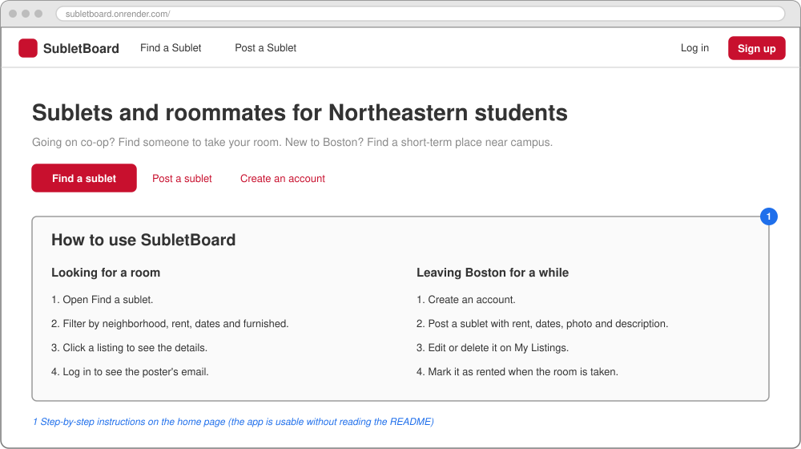
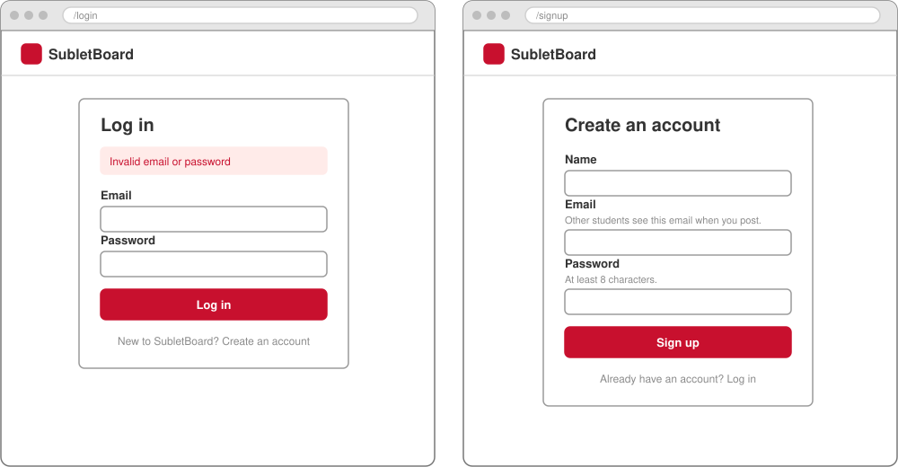
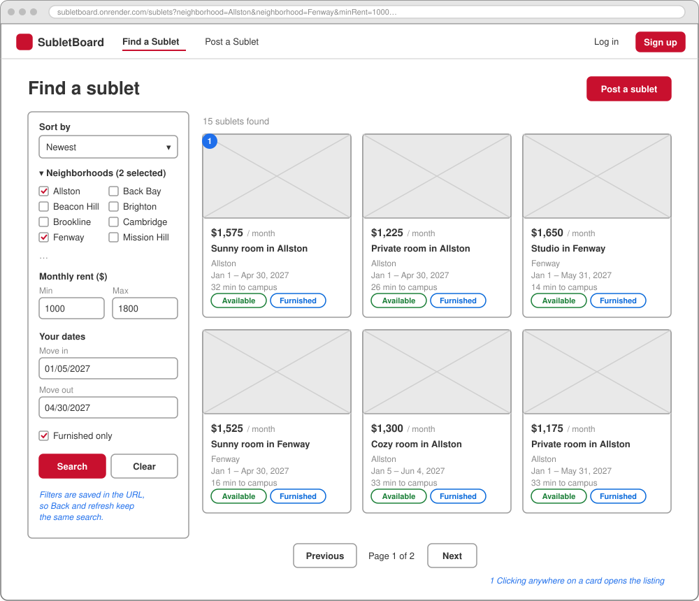
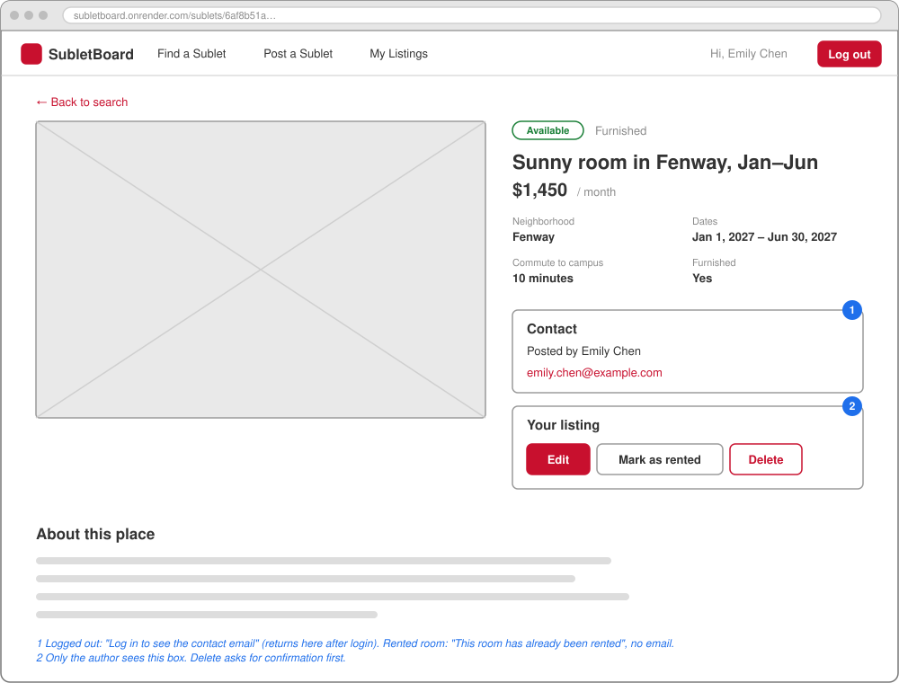
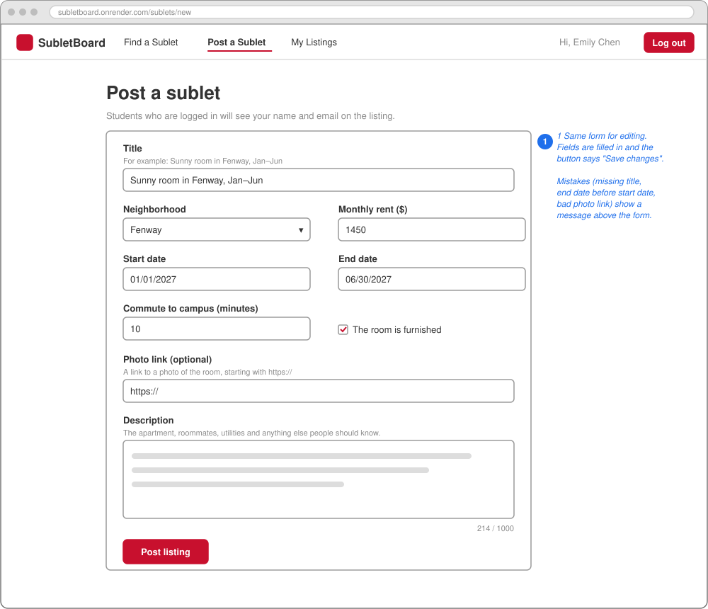
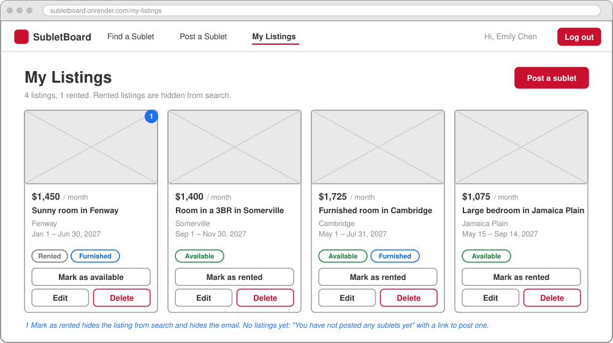

# SubletBoard Design Document

Team: Jiaying Guo and Yanli Wang

Class: [CS5610 Web Development, Fall 2026](https://johnguerra.co/classes/webDevelopment_online_fall_2026/), Northeastern University

## Project Description

SubletBoard helps Northeastern students find sublets and roommates.

Many Northeastern students leave Boston for a co-op or a semester and need someone to take their room, while new students need a short-term place to stay or someone to split rent with. Right now this happens in messy Facebook groups and group chats, where posts get buried in a few days and it is hard to search by price, dates or neighborhood.

SubletBoard gives students one place to post and find sublets, and to find a roommate who fits their budget and lifestyle. Students can search sublets by neighborhood, price, dates and furnished, and search roommate profiles by budget, neighborhood, move-in date, sleep schedule, pets and smoking. Students log in to post and to see contact emails, and only the author can edit or delete their own listings and profiles.

The app has two independent features: sublet listings and roommate profiles. They are stored in separate collections and never read each other. Each listing or profile saves the poster's name and contact email when it is created. The database has more than 1,000 synthetic sublet listings and more than 1,000 synthetic roommate profiles.

## User Personas

**Emily** is a grad student going on a co-op in another city from January to June. She wants to find someone to take her room so she does not pay rent for an empty room.

**Daniel** is a new grad student arriving in January. He needs a furnished room near campus for one semester and has a tight budget.

**Priya** is a student who wants to move into a bigger apartment and split the rent. She stays up late and has a cat, so she needs a roommate who is fine with that.

**Marcus** is a student who gets up early and wants a quiet roommate. He already found a roommate once and wants to hide his profile until next year.

## User Stories

### Jiaying Guo: sublet listings

1. As Emily, I want to sign up and log in so that only I can edit or delete my listings.
2. As Emily, I want to create, edit, and delete sublet listings with the neighborhood, rent, start and end dates, furnished or not, commute time to campus, a photo link, and a description so that I can find someone to take my room.
3. As Daniel, I want to search and filter sublets by neighborhood, price range, dates, and furnished, and open a listing to see its details and the poster's contact email, so that I can find a room that fits my budget and my semester.
4. As Emily, I want to see all my listings on one page and mark a listing as rented so that people stop contacting me about it.

### Yanli Wang: roommate profiles

5. As Priya, I want to create, edit, and delete my roommate profile with my budget, preferred neighborhoods, move-in date, sleep schedule, pets, smoking, and a short bio so that other students can get to know me.
6. As Priya, I want to search and filter roommate profiles by budget, neighborhood, move-in date, sleep schedule, pets, and smoking, and open a profile to see the contact email, so that I can find someone who fits my lifestyle.
7. As Marcus, I want to see my own profile on a My Profile page, and hide it from search after I find a roommate and show it again later, so that I only get messages when I am looking.

## Changes From the Proposal

- Each sublet listing has a short title, so listings are easy to tell apart in the search results.
- Sublet search results can be sorted by newest or by price, and are split into pages of 12.
- When a listing is marked as rented, it is hidden from search and its detail page no longer shows the contact email, so people stop contacting the poster.
- The photo link is optional. Listings without a photo, or with a broken link, show a "No photo" picture. The synthetic listings use eight sample room pictures that come with the app, so the demo does not depend on an outside photo website.
- Besides the libraries approved in the proposal (dotenv, @faker-js/faker and connect-mongo), the app uses passport-local and express-session, which are the standard way to use Passport with a username and password, and react-router-dom and prop-types, which the project requirements ask for.

## Design Mockups

All pages share the same header: the SubletBoard logo, the links Find a Sublet and Post a Sublet, and Log in and Sign up. After logging in, the header also shows My Listings, the student's name and a Log out button. Blue numbers in the mockups point to notes under each picture.

### Jiaying Guo: sublet listings

#### Home page

The home page explains what SubletBoard is and has step-by-step instructions for both kinds of users: students looking for a room and students leaving Boston. The buttons go straight to searching or posting.

#### Log in and sign up (story 1)

Students sign up with a name, email and password, and log in with their email and password. If the email or password is wrong, a message shows above the form. After logging in, students return to the page they were on, for example the listing whose email they wanted to see.

#### Find a sublet (story 3)

The filters are on the left: neighborhoods (more than one can be chosen), minimum and maximum monthly rent, move-in and move-out dates, and furnished only. The sort menu changes the order right away (newest, price low to high, price high to low). Each card shows the photo, rent, title, neighborhood, dates, commute time, and whether the room is furnished. Results come 12 per page. The search is saved in the address bar, so the back button and refresh keep it, and a search can be shared as a link.

When both dates are filled in, the results only include rooms available for the whole stay. Rented listings never show up in search.

#### Listing details (stories 3 and 4)

The detail page shows the photo, the rent, all the facts and the description. The contact box shows the poster's name. The email is only shown to students who are logged in, and it is hidden once the room is rented. The author of the listing also sees buttons to edit it, mark it as rented (or available again) and delete it.

#### Post or edit a sublet (story 2)

One form is used to post a new listing and to edit one. It has the title, neighborhood, monthly rent, start and end dates, commute time to campus, furnished, an optional photo link and a description. Mistakes are explained in a message above the form before anything is saved.

#### My Listings (stories 2 and 4)

My Listings shows every listing the student posted, including rented ones, with a count at the top. Each card has buttons to mark it as rented or available, edit it, and delete it.

## Data

We use MongoDB with four collections. `sublets` and `roommates` are the two collections with full create, read, update and delete. `users` and `sessions` only support login.

| Collection  | Owner                    | Where the data comes from                   | Main fields                                                                                                                                                   |
| ----------- | ------------------------ | ------------------------------------------- | ------------------------------------------------------------------------------------------------------------------------------------------------------------- |
| `sublets`   | Jiaying Guo              | 1,200 synthetic listings (Faker), and users | title, neighborhood, rent, startDate, endDate, furnished, commuteMinutes, photoUrl, description, status, authorId, authorName, authorEmail, seeded, createdAt |
| `roommates` | Yanli Wang               | Synthetic profiles (Faker), and users       | Added by Yanli Wang                                                                                                                                           |
| `users`     | Jiaying Guo              | Synthetic users (Faker), and sign ups       | name, email, passwordHash, salt, seeded, createdAt                                                                                                            |
| `sessions`  | Created by connect-mongo | Login sessions                              | session data and expiry date                                                                                                                                  |

The synthetic data is generated with a fixed Faker seed, so running the seed scripts again gives the same records. The seed scripts only replace records marked `seeded: true`, so accounts and listings created by real users are kept.

The sublet seed creates 101 students (one is the demo account) and 1,200 listings across 16 Boston neighborhoods. Rents depend on the neighborhood (from $900 to about $2,500 a month), most listings start around the beginning of a semester or co-op (January, May or September) and last 2 to 8 months, about two thirds are furnished, and about 15% are already rented.

## Tech Stack

- Frontend: React with hooks, React Router, Fetch API, built with Vite
- Backend: Node.js and Express with ES modules
- Authentication: Passport with a local strategy (email and password), sessions saved in MongoDB with connect-mongo
- Database: MongoDB with the native Node.js driver
- Deployment: Render, with MongoDB Atlas
